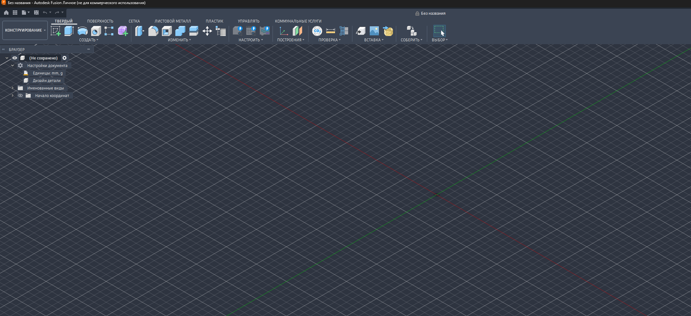
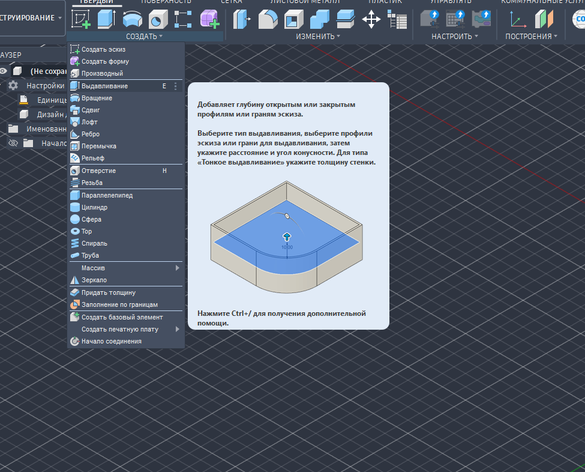

# RusFusion — русификатор Autodesk Fusion

Переводит интерфейс Fusion на русский: меню, кнопки, подсказки, сообщения, CAM. Перевод ставится в собственный русский слот Fusion, поэтому язык выбирается обычным способом в настройках.

## Чем отличается

Перевод собирается из нескольких источников по очереди:

| Приоритет | Источник | Что даёт |
|---|---|---|
| 1 | **Словарь RusFusion** (`glossary.py`) | Названия основных команд в привычной САПР-терминологии: Выдавливание, Круговой массив, Оболочка… |
| 2 | **Ручной перевод сообщества [RusFus](https://github.com/RusFus/fusion360-rus-files)** | Около 80% интерфейса переведено людьми. Перевод скачивается при установке из [fusion360-russian-localization](https://github.com/kiryxabykiryxaby/fusion360-russian-localization) |
| 3 | **Память переводов** | Если такой же текст где-то уже переведён вручную, перевод берётся оттуда |
| 4 | **Машинный перевод** | Только новые строки, которых пока нет у сообщества: свежие функции из последних обновлений |

Что ещё умеет RusFusion:
- **Защита от вылетов.** Если перевод сломал служебные вставки (`%1%`, `{name}`), строка остаётся на английском, и Fusion не падает.
- **Без устаревших строк.** Если Autodesk изменил английский текст, старый ручной перевод не подставляется.
- **Автообновление.** После обновления Fusion перевод сам переустанавливается при входе в Windows.
- **Справка и строки CAM** на русском.
- **Отчёт.** После установки показывается, сколько строк взято из каждого источника.

## Установка

1. Установи [Python 3](https://www.python.org/downloads/) и отметь «Add python.exe to PATH».
2. Скачай репозиторий (**Code → Download ZIP**) и распакуй.
3. Закрой Fusion и запусти **RUSIFY.bat**. Первый запуск занимает несколько минут, нужен интернет.
4. В Fusion открой **Preferences (Ctrl+,) → General → User Language → Russian** и подтверди перезапуск.

## Удаление

Запусти **RESTORE.bat** и выбери в настройках Fusion English.

## Помочь с переводом

Нашёл кривую надпись? Добавь её в `glossary.py` в формате `"English": "Русский"` и пришли pull request, или открой issue со скриншотом.

## Благодарности

- Ручной перевод: сообщество **RusFus**.
- Установщик и поиск активной сборки: **[fusion360-russian-localization](https://github.com/kiryxabykiryxaby/fusion360-russian-localization)**.

Файлы перевода RusFus не хранятся в этом репозитории: они скачиваются у авторов при установке.

Это неофициальный проект, он не связан с Autodesk. Используешь на свой риск. Autodesk и Fusion являются товарными знаками Autodesk, Inc.
